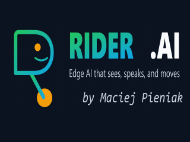
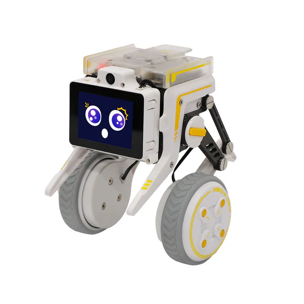

<p align="center">
  
</p>

# Rider-Pi 1.0.0

[](https://github.com/mpieniak01/Rider-Pi/releases/tag/v1.0.0)
[](https://github.com/mpieniak01/Rider-Pi/actions/workflows/tests.yml?query=branch%3Amain)
[](https://github.com/mpieniak01/Rider-Pi/actions/workflows/quality-guard.yml)
[](https://sonarcloud.io/summary/new_code?id=mpieniak01_Rider-Pi&branch=main)
[](https://sonarcloud.io/component_measures?id=mpieniak01_Rider-Pi&branch=main&metric=coverage&view=list)
[](https://snyk.io/test/github/mpieniak01/Rider-Pi)
[](https://github.com/mpieniak01/Rider-Pi/pulls)

[English README](README.md) · [Dokumentacja](docs_pl/README.md) · [Opis wydania](docs_pl/release-notes/v1.0.0.md)

Niezależne oprogramowanie edukacyjne dla dwukołowego robota Yahboom Rider-Pi.
Uruchamia lokalne aplikacje, udostępnia panel operatora i pozostawia wykonanie
sprzętowe na Raspberry Pi. To projekt społecznościowy, niezwiązany z producentem.

<p align="center">
  <a href="./data/Rider-Pi_01_a64b25c8-2cba-4f4e-b1d8-8cd5d543a9fb_600x.webp">
    
  </a>
</p>

## Wskaźniki jakości

| Wskaźnik | Co pokazuje |
| --- | --- |
| Tests | Ostatni przebieg `main`: testy programowe i API w Pythonie 3.9 oraz izolowane testy JavaScript. |
| Quality Guard | Ostatni przebieg PR: Ruff 0.6.9, limity zmienianych plików Python, statyczna walidacja systemd i kontrole API. |
| SonarCloud | Aktualną bramkę jakości `main`; CI importuje pokrycie Python i JavaScript dla analizowanej rewizji. |
| Coverage | Całkowite pokrycie `main`; bramka osobno wymaga co najmniej 80% pokrycia nowego kodu. |
| Snyk | Zewnętrzny monitoring zależności. Odznaka może pokazywać **monitored**; ocenę sprawdzaj w kontrolach PR. |
| GitGuardian | Odznakę informacyjną skanowania sekretów w PR; właściwy wynik znajduje się w kontrolach konkretnego PR. |

Odznaki workflow pokazują ostatni przebieg w opisanym zakresie. Przed scaleniem
sprawdź wyniki bieżącego head PR, a po scaleniu nowy SHA `main`. Testy programowe
nie potwierdzają fizycznego bezpieczeństwa robota.
[Bramka jakości i odtwarzanie wyników](docs_pl/BRAMKA_JAKOSCI.md).

## Możliwości i granice

- **Panel operatora i API:** sterowanie ręczne, diagnostyka usług i zasobów,
  podgląd kamery, profile kalibracji i rewizja Git w stopce. HTTP API działa na
  porcie 8080; opcjonalny most ruchu używa 8081.
- **Wykonanie ruchu:** jeden wykonawca jest właścicielem UART. Polecenia zawierają
  identyfikator, generację, sekwencję i termin ważności; potwierdzenie polecenia
  jest rozróżnione od fizycznego wykonania. ARM i skasowanie E-Stop wymagają zgody operatora.
- **LCD:** animowana buźka, status urządzenia i splash startowy z wyłącznym
  właścicielem, kontrolą zasilania i wygaszeniem. Zachowujemy kompensację montażu 270°.
- **Kamera, głos i czat:** opcjonalne profile uruchamiane na żądanie, z jawnymi
  wymaganiami backendów. Integracje Google OAuth/SDK są opcjonalne i nie należą
  do podstawowego zestawu zależności testów programowych.
- **Integracja Venoma:** osobny moduł dostarcza opcjonalne obliczenia i ograniczone
  decyzje nawigacyjne. Pi zachowuje wykonanie sprzętowe i waliduje odpowiedzi.
  Konfiguracja, transport i dostępność modeli wymagają osobnego przygotowania.
- **Autonomia eksperymentalna:** moduły Follow Me, map, odometrii i nawigacji
  służą rozwojowi oraz kontrolowanym próbom. Mapa i estymacja głębi nie zastępują
  zweryfikowanego czujnika kolizji ani nie gwarantują autonomicznego powrotu.

Przed wyborem tych profili przeczytaj [zasady ruchu i bezpieczeństwa](docs_pl/apps/safety.md),
[kontrakt nawigacji kierunkowej](docs_pl/DIRECTIONAL_NAVIGATION.md) i
[obliczenia w Venomie](docs_pl/COMPUTE_VENOM.md).

## Runtime i przygotowanie

Wspierana baza urządzenia to obraz producenta Raspberry Pi OS / Debian 11
Bullseye i **Python 3.9**. Nowszy Python WSL nie potwierdza możliwości aktualizacji
runtime robota. Wersja 1.0.0 dotyczy tego projektu, osobno od SDK producenta,
firmware i kontraktów HTTP; [VERSION](VERSION) zawiera metadane wydania.

Dla istniejącego robota stosuj [wdrożenie i odtwarzanie](docs_pl/WDROZENIE.md),
a development przygotuj według [polityki środowisk](docs_pl/POLITYKA_SRODOWISK.md).
Pi, Rider-PC i Venom zachowują osobne zależności. Na Pi instalujemy pakiety
potrzebne wybranemu profilowi; narzędzia dev/test pozostają w WSL/CI.
Zachowaj istniejącą konfigurację lokalną i sekrety.

Na przygotowanym Pi te żądania wyłącznie odczytują stan:

```sh
curl --fail http://127.0.0.1:8080/healthz
curl --fail http://127.0.0.1:8080/api/safety
curl --fail http://127.0.0.1:8080/api/status/version
```

Przegląd urządzenia: `http://<robot-ip>:8080/`; panel operatora: `/control`.
Otwarcie strony ani wdrożenie kodu nie upoważnia do ARM lub ruchu. Ruch wymaga
osobnego planu zatwierdzonego przez operatora i przygotowanego miejsca.

## Development

Z katalogu Rider-Pi używaj istniejącego venv projektu:

```sh
.venv/bin/python --version
make test-env
make lint
make test TEST_ARGS='-q tests/test_version_api.py tests/test_boot_lcd_handover.py'
```

To wybrane testy programowe. CI sprawdza także Python 3.9 i pełne izolowane
zestawy pokrycia Python/JavaScript w workflow Sonara. Sprzęt, ruch fizyczny
oraz testy sieciowe są wyłączone z tego automatycznego zestawu.
[Development](docs_pl/development.md), [instrukcje współpracy](AGENT.md).

Wydanie aplikacji: lokalny commit i podgląd wybranego zakresu na Pi, potem PR,
kontrole, review, merge i wdrożenie dokładnego SHA `main`. W razie potrzeby
restartujemy tylko zmienioną usługę. Sama dokumentacja nie wymaga restartu sprzętu.
[Wersjonowanie i tagi](docs_pl/WERSJONOWANIE.md).

## Mapa projektu

| Katalog | Odpowiedzialność |
| --- | --- |
| `apps/` | Aplikacje robota, wykonawca bezpieczeństwa, LCD, kamera, głos i nawigacja. |
| `services/` | HTTP API, orkiestracja oraz projekcje usług i zasobów. |
| `common/`, `drivers/` | Wspólne kontrakty i kontrolowany dostęp do sprzętu. |
| `web/` | Panel operatora i zasoby webowe. |
| `config/`, `systemd/`, `scripts/` | Publiczne wzory konfiguracji, unity i narzędzia obsługi. |
| `tests/` | Izolowane regresje programowe i jawnie oznaczone testy sprzętowe. |
| `docs_pl/`, `docs/` | Utrzymywana dokumentacja polska i angielska. |

## Dokumentacja

- [Wizja projektu](docs_pl/PROJECT.md), [architektura](docs_pl/ARCHITECTURE.md) i [indeks dokumentacji](docs_pl/README.md).
- [Kontrakty API](docs_pl/api-specs/README.md), [panel operatora](docs_pl/ui/operator-panel.md) i [kalibracja](docs_pl/apps/calibration.md).
- [Własność LCD i start](docs_pl/apps/face-lcd.md), [kamera](docs_pl/apps/camera.md) i [głos](docs_pl/apps/voice.md).
- [Mapowanie usług systemd](docs_pl/SYSTEMD_SERVICES_MAPPING.md) i [polityka konfiguracji](docs_pl/config/POLICY.md).
- [Wydanie 1.0.0](docs_pl/release-notes/v1.0.0.md), [wersjonowanie](docs_pl/WERSJONOWANIE.md) i [polityka dokumentacji](docs_pl/POLITYKA_DOKUMENTACJI.md).


Aktualne przewodniki: [ręczne tryby pulse/hold/release](docs_pl/api-specs/manual-motion.md),
[własność panelu](docs_pl/manual-panel-authority.md),
[parametry polityki r2](docs_pl/vision-policy-parameters.md) i
[referencja pomiarowa obrazu](docs_pl/IMAGE_REFERENCE.md).

## Licencja i współpraca

Zapraszamy do zgłaszania uwag i zmian. Projekt korzysta z [licencji MIT](LICENSE).
Podziękowania dla platformy Yahboom/XGO i społeczności Python, OpenCV oraz ZMQ.

Copyright (c) 2025–2026 Maciej Pieniak.
