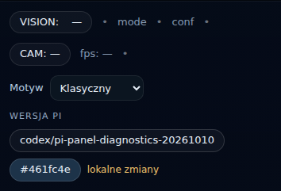

# Panel Pi: diagnostyka, nawigacja i wersja

Stan na 2026-10-10: zmiana zaimplementowana i sprawdzona w gałęzi PR.
Urządzenie nadal serwuje poprzednią wersję `main / 461fc4e`; nie wykonano wdrożenia ani restartu.

## Role ekranów

| Trasa Pi, port 8080 | Rola |
| --- | --- |
| `/`, `/view` | Przegląd robota i podgląd obrazu |
| `/control` | Sterowanie robotem; istniejąca administracja usług oznaczona jako zaawansowana |
| `/system/` | Diagnostyka: odczyt usług i połączeń komponentów |
| `/navigation` | Podgląd nawigacji; wymaga opcjonalnego backendu WebSocket |
| `/chat` | Rozmowa i narzędzia głosowe |
| `/home`, `/google_home` | Zachowane bezpośrednie trasy integracji domowej, usunięte z menu |

`/home` pokazuje Google Feed, a nie stronę główną. Nazwy Sterowanie robotem / Diagnostyka
i ich opisy mają tłumaczenia PL/EN. Integracja głosowa Google pozostaje osobnym komponentem.

## Implementacja

Poprzedni System generował klasy niedopasowane do wspólnych stylów: 32 usługi układały
się w jedną kolumnę, a tabela rozszerzała dokument telefonu do 613–619 px przy ekranie 390 px.
Nowy widok używa grup, kart `c-card`, siatki `services-grid` i właściwych klas statusów.
Tabela znajduje się w rozwijanych szczegółach i przewija się we własnym kontenerze.

Diagnostyka pobiera wyłącznie `GET /api/services/graph`, co 5 sekund, z limitem 12 sekund
i jednym odczytem naraz. Błąd zachowuje ostatni udany wynik i pokazuje czas jego aktualizacji.
Nieaktywna usługa nie jest błędem. Połączenia pochodzą z katalogu komponentów `SERVICE_META`,
nie z zależności rozruchowych systemd. Stan `wifi-unblock.service=failed` jest zastany;
ta zmiana nie naprawia konfiguracji rozruchu ani sieci.

Wspólna stopka pobiera raz po załadowaniu `GET /api/status/version`:
`available`, `branch`, `commit`, `dirty`, `message`, `ts`.
Źródłem jest lokalne repo wyznaczone z położenia modułu, niezależnie od katalogu roboczego.
Git działa wyłącznie do odczytu, z limitem 1 sekundy na polecenie i cache 60 sekund,
również dla wyniku niedostępnego. Brak Git/repo zwraca HTTP 200 z `available=false`.
Detached HEAD jest oznaczony jawnie. Stopka obsługuje błędy HTTP, timeout, szablon awaryjny
i kopiowanie hasha na HTTP w LAN. Na telefonie zawija się i ma pozycję statyczną.
Szybkie ponowne kopiowanie restartuje komunikat i przywraca właściwy hash;
przypadek wskazany przez CodeRabbit jest objęty testem przeglądarkowym.

Rejestracja aliasów `/api/vision/*` używa jawnych reguł z osobną przestrzenią nazw,
bez opcji `name=` blueprintu dodanej dopiero w Flask 2.0.2.
Usunięto też powtórną rejestrację już obecnego blueprintu diagnostyki usług.

Krytyczne naprawy istniejącego CI: usunięte znaczniki konfliktu w Quality Guard,
sprawdzanie gotowości przez istniejące `/healthz`, właściwy port 8080 i start modułu API.
Poprawiono istniejące błędy Ruff w importach i adnotacjach `models_api.py`.
Nie dodano zadań CI, zależności, ochrony gałęzi ani zmian usług/portów.
Istniejący duży `api_server.py` wymaga etykiety PR `allow-oversize`.
Scenariusze sprzętowe pozostają wyłączone: job działa na `ubuntu-latest`, więc etykieta
`scenario-suite` nie udostępnia runnera Pi. Dalsza konfiguracja runnera wymaga osobnego
zakresu. Oczekiwanie na API sprawdza też PID i odrzuca już działający stary serwer.

## Testy i ograniczenia

| Kontrola | Wynik |
| --- | --- |
| Żywe panele przed zmianą: Pi 8 stron, PC 14 stron | 22 strony HTTP 200; 789 odpowiedzi; brak nieobsłużonych błędów JS i prób zapisów |
| Pi: endpoint wersji, mapa metod UI, trasy HTML, diagnostyka usług, Google Home, features, statyczne systemd i renderer | 76 passed |
| Pi: Chromium, wszystkie motywy i szerokości 320/390/768/1365 px, PL/EN, błędy/powrót API, wolny odczyt, stopka na 8 stronach | 33 passed |
| PC: domyślny zestaw `pc_client/tests` | 290 passed, 35 skipped |
| PC: istniejące testy API z `RIDER_ENABLE_API_TESTS=1` | 19 passed; adapter sprzętu wyłączony |
| Ruff 0.6.9 / format / diff whitespace / YAML i shell zmienionych workflow | passed |
| Urządzenie: izolowany test nowego modułu i aliasów Flask | Python 3.9.2 / Flask 1.1.2: HTTP 200, `main / 461fc4e`, bez lokalnych zmian |

Testy metod dopasowują trasy bez wykonywania poleceń ruchu i administracji usług.
Kontrolowany zły payload Pi zwraca 400, zła metoda 405, nieznana trasa 404.
Testy Chromium używają przechwyconych odpowiedzi; nie klikają prawdziwego sterowania.
W WSL wykorzystano już zainstalowane środowiska Pi i PC, bez instalacji nowych pakietów.

Pełny zestaw Pi w lokalnym środowisku: **572 passed, 8 failed, 16 skipped, 22 deselected**.
Wszystkie 8 niepowodzeń odtworzono na niezmienionym `origin/main / 461fc4e`:

- Trzy asercje trybu offload detektorów (`test_ai_mode_adapters`, `test_ai_mode_dynamic_switching`).
- Dwa testy animacji wymagają lokalnego serwera API na 8080, którego nie uruchamiano.
- Dwa testy skryptu renderera wymagają właściwego `PATH` i `PYTHONPATH=.`; po ustawieniu przechodzą.
- Integracja symulatora ZMQ nie odbiera oczekiwanej komendy (`test_simulator_mqtt`).

Nie oznaczamy całego repo Pi jako zielonego. Szczegóły kontraktów obu paneli są
w [raporcie tras](route-audit-20261010.json). Do dalszej pracy pozostają:

| Projekt / trasa | Wynik i znaczenie |
| --- | --- |
| Pi `GET /api/google/raw/last.json` | 404 `no_snapshot`: oczekiwany brak danych wyłączonego feedu |
| Pi `/ws/navigation` | handshake 404: opcjonalny backend nie jest włączony na urządzeniu |
| PC `/ws/navigation` | handshake 403: brak zarejestrowanego backendu tej strony |
| PC `GET /api/google/status`, `/api/google/raw/last.json` | 404: ekran Google Feed wywołuje nieistniejące trasy PC |
| PC `GET /api/proxy/pi/status`, `POST /api/proxy/pi/set-model` | Brak tras wymaganych przez ekran Models; istniejący `/api/models/*` ma inny kontrakt |
| PC `POST /api/control/balance`, `/api/control/height` | Brak tras używanych przez Sterowanie; nie wykonywano poleceń na robocie |
| PC `POST /vision/tracking/mode` | Brak aliasu; `/api/vision/tracking/mode` istnieje |

Kontrola payloadu tracking PC bez adaptera zwraca 400. Przy niedostępnym adapterze
zwraca 502; obecna warstwa proxy nie zachowuje rozróżnienia błędu walidacji backendu.
Zatrzymanie audytu przerywało część trwających odczytów; takich przerwań nie klasyfikujemy
jako brakujących tras. Audyt blokował również zewnętrzne porty monitoringu.
Ten PR dotyczy Pi; wymienione luki PC wymagają osobnego przyrostu.

## Dowody wizualne

Zrzuty „po” to lokalny podgląd kodu PR z rzeczywistym odczytanym grafem 32 usług Pi.
Wersja w tym podglądzie wskazuje robocze repo PR. Nie są dowodem wdrożenia na urządzeniu.
Desktop: 1365 px / 4 kolumny; telefon: 390 px / 1 kolumna; dokument mieści się w ekranie.

| Przed | Po |
| --- | --- |
| [Desktop](../assets/panel-pi-20261010/system-desktop-before.png) | [Desktop](../assets/panel-pi-20261010/system-desktop-after.png) |
| [Telefon](../assets/panel-pi-20261010/system-mobile-before.png) | [Telefon](../assets/panel-pi-20261010/system-mobile-after.png) |



## Ponowienie kontroli

W środowisku z istniejącymi zależnościami projektu:

```bash
PYTHONPATH=. RIDER_PI_CI=1 RIDER_PI_MOCK_HW=1 pytest -q tests/test_version_api.py tests/test_panel_route_contract.py tests/test_web_routes.py tests/test_services_dashboard_api.py tests/test_api_server_google_home.py
ruff check apps tests services common
ruff format --check apps tests services common
```

Opcjonalne testy przeglądarki: `pytest tests/test_dashboard_browser.py` w środowisku
z już dostępnym Playwright/Chromium; `RIDER_TEST_BROWSER` pozwala wskazać istniejący plik
wykonywalny. Bez Playwright moduł jest pomijany. Nie dodano nowej bramki CI.

Wdrożenie jest osobnym krokiem: po scaleniu sprawdzić faktyczną rewizję procesu API
i wykonać odczyty HTML, grafu oraz wersji. Dane Git opisują repo na dysku, nie dowodzą,
że proces po zmianie plików przeładował już kod. W tym przyroście nie zmieniano boot managera,
systemd, SSH, sieci ani bibliotek/pinów sterowania sprzętem.
