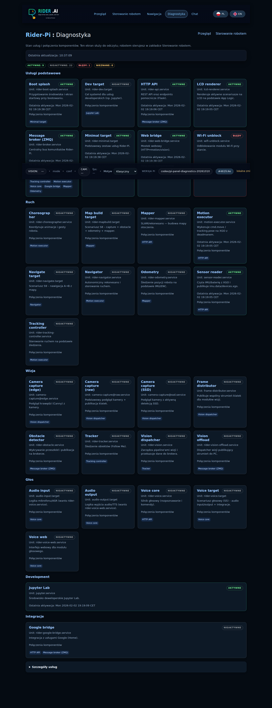
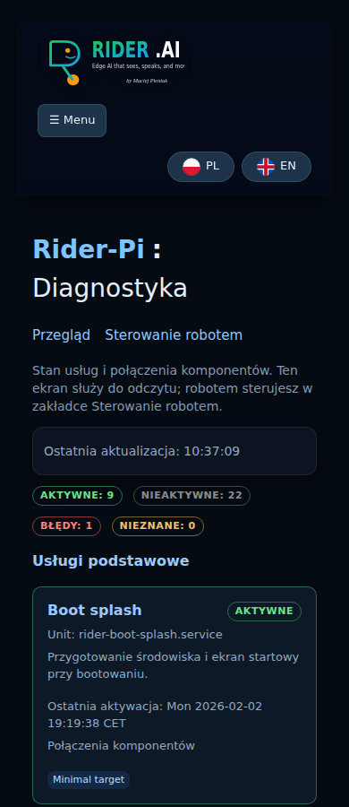

# Panel Pi: diagnostyka i wersja

Flask udostępnia panel na porcie `8080`. `/` i `/view` pokazują przegląd,
`/control` sterowanie robotem, a `/system/` diagnostykę. Administracja usługami
pozostaje w zaawansowanej części sterowania. `/home` jest ekranem Google Feed.
`/home` i `/google_home` są dostępne bezpośrednio, lecz ukryte w bieżącym menu.
Interfejs obsługuje język polski i angielski.

Diagnostyka pokazuje karty usług według komponentów oraz rozwijaną tabelę.
Liczniki rozróżniają usługi nieaktywne i awarie. Powiązania z `SERVICE_META`
opisują komponenty aplikacji, bez deklarowania zależności rozruchowych systemd.
Ekran co pięć sekund odczytuje `GET /api/services/graph`, utrzymując jedno
żądanie naraz i limit dwunastu sekund. Po błędzie zachowuje ostatnie dane
i oznacza je jako nieaktualne. Nie wysyła poleceń ruchu ani zarządzania usługami.

Stopka odczytuje `GET /api/status/version` po załadowaniu strony. Odpowiedź
zawiera `available`, `branch`, `commit`, `dirty`, `message` i `ts`.
Źródłem jest repozytorium uruchomionego kodu, odczytane poleceniami Git z limitem
jednej sekundy i cache na sześćdziesiąt sekund. Brak danych zwraca HTTP 200
z `available=false`; detached HEAD jest opisany jawnie. Kopiowanie commita
działa też przez fallback schowka przy HTTP w LAN. Na małych ekranach
stopka zawija się i pozostaje w zwykłym układzie dokumentu.

Sprawdzając zmiany, uwzględnij kontrakty API, cztery motywy, różne szerokości
ekranu, oba języki, wolne i błędne odpowiedzi oraz stopkę na każdej stronie.
Wyniki konkretnych audytów zapisuj lokalnie.

